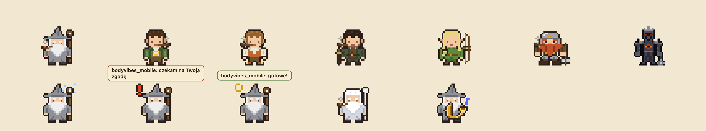

# Fellowship Desktop

Gandalf (albo ktoś inny z Drużyny) stoi na pulpicie Maca i pokazuje, co robi Claude Code.



| Stan Claude Code | Co robi postać |
|---|---|
| pracuje | maszeruje (animacja pracy) |
| czeka na Twoją zgodę lub odpowiedź | podskakuje, czerwony dymek z nazwą projektu |
| skończył | podskakuje, zielony dymek „gotowe!”; kliknij postać, żeby odpoczęła |
| nic się nie dzieje | pyka fajkę |

Kliknięcie postaci, gdy Claude pracuje albo odpoczywa, odpala sztuczkę (za każdym razem inną). Każda kończy się
cytatem z filmów; dymek zostaje tak długo, żeby dało się go przeczytać:

| Postać | Sztuczka → cytat |
|---|---|
| Gandalf | fajerwerki → *Meriadoc Brandybuck and Peregrin Took. I might have known.*; pękająca ziemia → *You shall not pass!*; kółka z dymu → *All you have to decide is what to do with the time that is given to you.*; obrót z iskrami → *A wizard is never late, Frodo Baggins.*; Epic Sax Gandalf zamiast fajki gra solo → *Fly, you fools!* |
| Frodo | znika z Pierścieniem pod okiem Saurona → *I wish the Ring had never come to me.*; taniec → *Underhill. My name's Underhill.*; świecące Żądło → *I will take it. I will take the Ring to Mordor.*; liście Lórien → *It's a dangerous business, Frodo, going out your door.* |
| Sam | żonglerka ziemniakami → *Po-tay-toes! Boil 'em, mash 'em, stick 'em in a stew.*; kwiatki → *If I take one more step, it'll be the farthest away from home I've ever been.*; patelnia → *I think I'm getting the hang of this!*; → *I can't carry it for you, but I can carry you!* |
| Aragorn | szarża → *For Frodo.*; cięcie mieczem → *You have my sword.*; korona → *My friends, you bow to no one.*; athelas → *If by my life or death I can protect you, I will.* |
| Legolas | strzały → *Final count: forty-two.*; zjazd na tarczy → *You have my bow.*; elfi wzrok → *They're taking the hobbits to Isengard!*; salto → *A red sun rises. Blood has been spilled this night.* |
| Gimli | rzut krasnoludem → *Nobody tosses a Dwarf!*; topór → *And my axe!*; kufel → *Certainty of death. Small chance of success. What are we waiting for?*; tupanie → *We dwarves are natural sprinters. Very dangerous over short distances.* |
| Sauron | płonące Oko → *Ash nazg durbatulûk.*; krążący Pierścień → *One Ring to rule them all.*; ciemność → *My master, Sauron the Great, bids thee welcome.*; pioruny → *Against the power of Mordor there can be no victory.* |

Konkretną sztuczkę wybierzesz z menu **Sztuczki** na pasku.

Przy kilku sesjach naraz postać pokazuje najpilniejszą: czeka > pracuje > skończył > odpoczywa.

Kliknięcie postaci, gdy Claude czeka lub skończył, przenosi do tej sesji (do najnowszej, jeśli jest ich kilka).
Menu na pasku pokazuje wszystkie sesje, a kliknięcie pozycji przenosi do jej okna:

| Gdzie działa Claude Code | Dokąd przenosi |
|---|---|
| VS Code, Cursor, Windsurf | okno z folderem projektu |
| Terminal, iTerm | karta z sesją; za pierwszym razem macOS pyta o zgodę na sterowanie terminalem (bez niej tylko przełącza na aplikację) |
| aplikacja Claude i inne | przełącza na aplikację (bez wybierania konkretnej rozmowy) |

Działa z Claude Code w terminalu, w Herdrze, w VS Code i w aplikacji desktopowej Claude, bo wszystkie czytają te
same hooki z `~/.claude/settings.json`.

## Instalacja

Wymaga macOS 13+ na Apple Silicon i Xcode (albo Command Line Tools ze Swiftem 5.10+).

```bash
git clone <ten-repo> && cd fellowship-desktop
scripts/install.sh
```

Skrypt buduje aplikację, kopiuje ją do `~/Applications/FellowshipDesktop.app` i uruchamia. Nic poza tym nie zmienia.

### Status Claude Code (opcjonalnie)

```bash
scripts/install-hooks.sh
```

Dopisuje do `~/.claude/settings.json` hooki `SessionStart`, `UserPromptSubmit`, `PreToolUse`, `PostToolUse`,
`PermissionRequest`, `Notification`, `Stop` i `SessionEnd`. Przed zmianą robi kopię
(`settings.json.fellowship-backup-<data>`), inne ustawienia i hooki zostawia. Można go uruchomić drugi raz.
Usunięcie: `scripts/install-hooks.sh --remove`.

Hook to ta sama aplikacja wywołana jako `FellowshipDesktop hook`: czyta JSON od Claude Code i zapisuje stan sesji
w `~/Library/Application Support/FellowshipDesktop/sessions/`. Trwa ok. 15 ms, nic nie wypisuje i nie łączy się
z siecią.

## Menu na pasku

Ikonka postaci na pasku menu:

- **Postać**: Gandalf, Frodo, Sam, Aragorn, Legolas, Gimli, Sauron
- **Edycja**: losowa przy starcie (10% rzadka, 1% Epic Sax Gandalf), zwykła, rzadka, Epic Sax Gandalf
- **Rozmiar**: mała, średnia, duża
- **Sztuczki**: odpala wybraną sztuczkę postaci
- dźwięk, gdy Claude czeka lub skończy; uruchamianie przy logowaniu
- ukryj / pokaż, przywróć w prawy dolny róg

Postać przeciągasz myszką. Klika się tylko w samą postać, reszta okna przepuszcza kliknięcia.

## Rozwój

```bash
swift test                                   # testy
swift run FellowshipDesktop                  # uruchomienie z repo (sprite'y z Sprites/)
swift run FellowshipDesktop preview out.png  # arkusz z postaciami, jak docs/preview.png
swift run FellowshipDesktop tricks out/      # arkusz ze sztuczkami każdej postaci (5 klatek na sztuczkę)
scripts/build-app.sh                         # build/FellowshipDesktop.app
```

## Licencje

- Kod: MIT, zob. [LICENSE](LICENSE).
- Pikselowe postacie w `Sprites/` pochodzą z
  [joaovitorwoliveira/herdr-middle-earth](https://github.com/joaovitorwoliveira/herdr-middle-earth)
  (MIT, © 2026 joaovitorwoliveira), zob. [Sprites/LICENSE](Sprites/LICENSE).
- Projekt fanowski, niezwiązany z Middle-earth Enterprises, Tolkien Estate ani Warner Bros.
